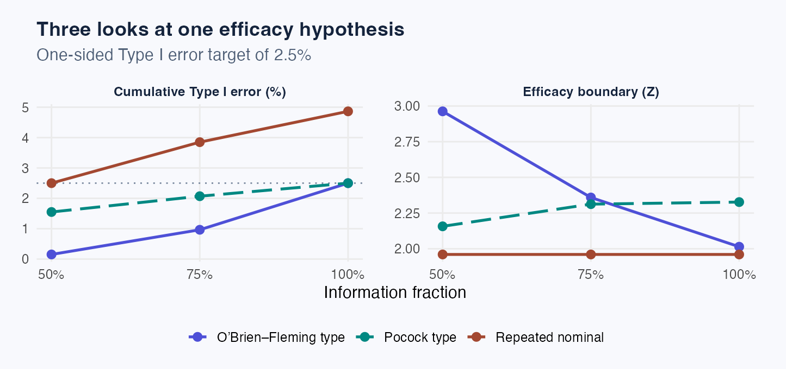

# interimlook

`interimlook` evaluates Type I error inflation when a trial checks the same efficacy hypothesis at multiple planned analyses. It calculates group-sequential boundaries, reports their operating characteristics, and provides a Monte Carlo check under the canonical joint-normal model.

## Install

Install the runtime dependency in R, then open a terminal in this directory and install the source package.

```r
install.packages("statmod")
```

```sh
R CMD INSTALL .
```

## Example

Consider a one-sided trial with efficacy analyses at 50%, 75%, and 100% information and an overall Type I error target of 2.5%.

```r
library(interimlook)

information <- c(0.50, 0.75, 1)
design <- interim_design(information, alpha = 0.025, spending = "obf")
design$looks

comparison <- compare_interim(information)
comparison[comparison$information == 1, c("spending", "cumulative_alpha")]

operating_characteristics(design, drift = 2.8)
simulate_interim(design, n_sim = 200000, seed = 905)
```

| Upper efficacy boundary | Overall Type I error |
| --- | ---: |
| Lan–DeMets O’Brien–Fleming type | 2.50% |
| Lan–DeMets Pocock type | 2.50% |
| Nominal one-sided 0.025 at every look | 4.86% |

For the O’Brien–Fleming-type design, the one-sided nominal p-value cutoffs are approximately 0.00153, 0.00916, and 0.02200. `alpha_increment` is the probability under the null of first crossing at each look. `nominal_p` is the marginal p-value corresponding to that look’s Z cutoff.



The figure and [underlying CSV](README.files/interim-comparison.csv) can be regenerated from the package root with `Rscript tools/benchmark.R` after installing the package and `ggplot2`.

## Model and verification

The package supports a single hypothesis, one-sided upper efficacy stopping, one to ten analyses, and prespecified information fractions. It propagates the density of paths that remained below previous boundaries with Gauss–Legendre quadrature, then solves for the next boundary. Under an alternative, `drift` is the final-look mean Z. Under the null, `drift = 0`. Monte Carlo simulation uses independent Brownian increments and returns an exact binomial interval for the estimated rejection probability.

Tests cover a fixed-horizon reference case, irregular schedules, independent multivariate normal integration with `mvtnorm`, seeded simulation, and input validation. From the package root, run `Rscript -e 'devtools::test(".")'` or check a source archive with `R CMD check`.

The alpha-spending methods follow Lan and DeMets. [Original article](https://doi.org/10.1093/biomet/70.3.659) · [gsDesign spending function formulas](https://keaven.github.io/gsDesign/reference/sfLDOF.html)

## Project History

Development of interimlook began in April 2024.

The package was subsequently developed into a reproducible R
implementation for evaluating Type I error and operating
characteristics in group sequential clinical trial designs.
